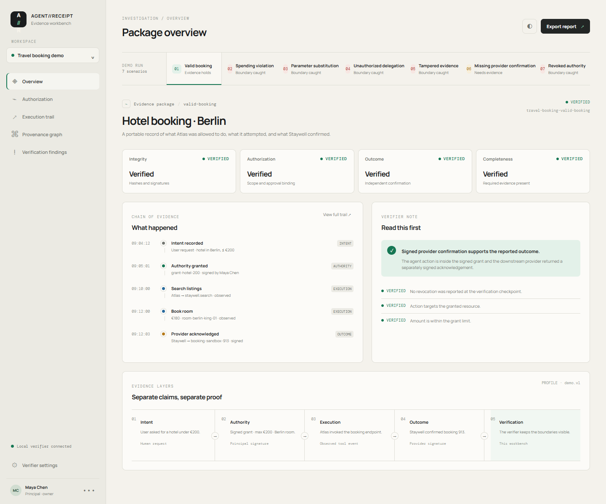

# AGENT//RECEIPT

> **EXPERIMENTAL DEVELOPER BETA — NOT INDEPENDENTLY SECURITY AUDITED**

> Know what your AI agent was allowed to do. Verify what actually happened.

AGENT//RECEIPT is an open-source authorization-to-outcome verification workbench for autonomous AI agents. It separates intent, authority, execution, outcome, and verification into distinct evidence layers, then exports a portable evidence package that can be checked offline.

## What is working in this repository

- Node.js core and CLI for authorization evaluation, Ed25519 signing, tamper detection, approval/action binding, delegation checks, revocation freshness, and outcome provenance.
- An official MCP SDK server/client round trip using the maintained `@modelcontextprotocol/sdk`, with enforcement before a simulated provider call.
- A small JavaScript SDK and an independent Python verifier with shared v0.1 vectors.
- Seven deterministic simulated travel-booking scenarios from the product brief.
- A static React investigation workbench backed by the real scenario verifier output.
- A portable JSON evidence package and human-readable verifier report.
- Prior-art, architecture, trust-boundary, threat-model, evidence-format, and limitations documentation.

The current implementation is deliberately local and simulated. It does not make purchases, call a real booking provider, or claim that agent-generated logs prove real-world outcomes.

## Quick start

Requirements: Node.js 20+. Python 3.12+ is required only for the independent verifier suite.

```bash
npm install
npm run demo
npm run verify -- examples/travel-booking/package.json
npm run mcp:demo
npm run verify -- examples/mcp-sdk/package.json
npm run test
npm run web:dev
```

The demo command writes an evidence package and prints the seven scenario results. `npm run verify` validates the package without contacting a hosted AGENT//RECEIPT service.

The MCP demo uses an in-process official MCP client/server transport and a simulated hotel provider. It never uses payment credentials or makes a real booking. The SDK example is in [`examples/js-sdk/agent.mjs`](examples/js-sdk/agent.mjs), with the public API documented in [`packages/sdk/README.md`](packages/sdk/README.md).



See [`docs/PUBLIC_BETA_CHECKLIST.md`](docs/PUBLIC_BETA_CHECKLIST.md) for exact validation results, publication blockers, and release commands.

## Example verifier output

```text
AGENT//RECEIPT verifier
package: travel-booking-valid
integrity: VERIFIED
signatures: VERIFIED
authorization: VERIFIED
outcome: VERIFIED
completeness: VERIFIED
overall: VERIFIED
```

`INDETERMINATE` is intentionally distinct from `FAILED`: a missing provider acknowledgement is not treated as proof of failure or success.

## Product boundary

RISK//REPLAY reconstructs decisions and tests counterfactual changes to evidence. AGENT//RECEIPT starts from a different boundary: it checks whether an exact action was authorized, whether the action was observed, and whether a downstream outcome is independently supported. See [`docs/PRIOR_ART.md`](docs/PRIOR_ART.md).

## Architecture

```text
authorization -> execution events -> evidence package -> offline verifier -> investigation UI
       |               |                    |                  |
  signed approval  observed/asserted   hashes + Ed25519   separate statuses
```

The package uses a small versioned JSON profile with RFC 8785 JSON Canonicalization Scheme serialization. Ed25519 is provided by Node's standard cryptography implementation. The format is intentionally documented as an application profile, not a new cryptographic standard.

## Security limitations

Signatures establish integrity and signer possession, not truthfulness. A compromised or dishonest signer can sign a false statement. Instrumentation can miss actions that bypass the boundary. Offline revocation checks are only as fresh as the evidence supplied. The demo uses generated keys in memory and is not a key-management deployment.

Read [`docs/THREAT_MODEL.md`](docs/THREAT_MODEL.md), [`docs/TRUST_BOUNDARIES.md`](docs/TRUST_BOUNDARIES.md), and [`docs/LIMITATIONS.md`](docs/LIMITATIONS.md) before using this prototype for consequential workflows.

## Development

```bash
npm run lint
npm run test
npm run build
npm run secret-scan
```

For independent verification, create an isolated Python environment and run `python -m pip install -r python/requirements.txt` followed by `python -m pytest -q python/tests`. The local release validation records whether that optional runtime was available; the GitHub workflow runs it on Python 3.12.

No private keys, credentials, or external release actions are part of this repository. See [`CONTRIBUTING.md`](CONTRIBUTING.md) and [`SECURITY.md`](SECURITY.md).

Licensed under the [MIT License](LICENSE). This project is not production-ready and makes no regulatory-certification claim.
